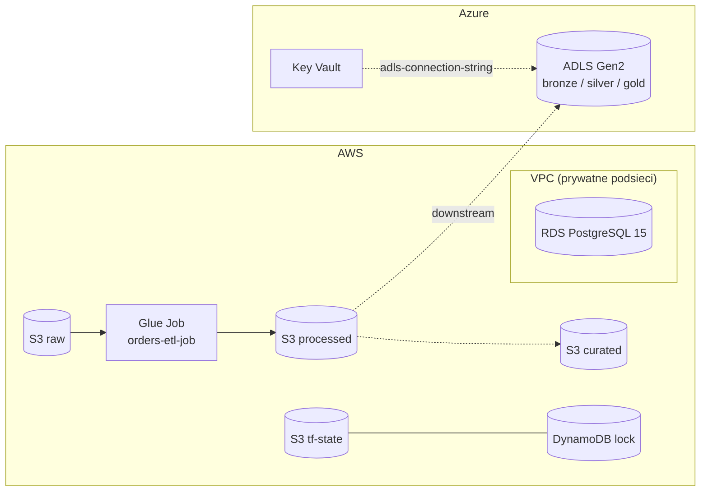

# E-commerce Data Platform - Terraform IaC

Infrastruktura pod pipeline danych e-commerce, w pełni zaprovisionowana przez
`terraform apply`


## Architektura

```
AWS                                    Azure
├── VPC: ecommerce-dev-vpc             ├── Resource Group: rg-ecommercemspi-dev
│   └── 2× prywatna podsieć (2 AZ)     ├── ADLS Gen2: stecommercedev
├── S3: ecommerce-dev-raw/             │   ├── bronze/
│   └── raw/orders/year=.../           │   ├── silver/
├── S3: ecommerce-dev-processed/       │   └── gold/
│   ├── scripts/orders_etl.py          └── Key Vault: kv-ecommerce-dev
│   └── processed/orders/year=/month=      └── sekret: adls-connection-string
├── S3: ecommerce-dev-curated/
├── S3: ecommerce-tf-state-eu-west-1-michal/  ← state
├── DynamoDB: terraform-state-lock     ← lock
├── RDS: PostgreSQL 15.x (db.t3.micro)
├── IAM Role: ecommercemspi-dev-glue-role
└── Glue Job: orders-etl-job
    └── skrypt: orders_etl.py

Terraform
├── module "glue_job"       ← reużywalny (conditional IAM Role via count)
└── module "azure_datalake" ← reużywalny (ADLS Gen2 + Key Vault)
```




## Struktura repozytorium

```
terraform/
├── main.tf
├── variables.tf
├── locals.tf
├── outputs.tf
├── vpc.tf
├── s3.tf
├── rds.tf
├── iam.tf
├── glue.tf
├── azure_providers.tf
├── azure_variables.tf
├── azure_main.tf
├── terraform.tfvars.example
├── .gitignore
└── modules/
    ├── glue_job/
    │   ├── main.tf
    │   ├── variables.tf
    │   └── outputs.tf
    └── azure_datalake/
        ├── main.tf
        ├── variables.tf
        └── outputs.tf

glue_scripts/
└── orders_etl.py

README.md
```

## Prerequisity

- AWS CLI skonfigurowane: `aws configure --profile ecommerce-dev`
- Azure CLI zalogowane: `az login` (albo Service Principal przez `ARM_*`)
- Terraform >= 1.7.0: `terraform --version`
- Bucket dla state i tabela DynamoDB już stworzone (patrz sekcja Bootstrap)

Sieć **nie** jest wymagana - domyślnie (`create_vpc = true`) Terraform tworzy
własne VPC z dwiema prywatnymi podsieciami w różnych AZ. Żeby użyć
istniejącego VPC, ustaw `create_vpc = false`, `vpc_id` i `private_subnet_ids`
w `terraform.tfvars`.

## Bootstrap - jednorazowy setup

```bash
# Stwórz bucket dla Terraform state
aws s3api create-bucket \
  --bucket ecommerce-tf-state-eu-west-1-michal \
  --region eu-west-1 \
  --create-bucket-configuration LocationConstraint=eu-west-1 \
  --profile ecommerce-dev

# Włącz versioning i szyfrowanie na buckecie state (dobra praktyka)
aws s3api put-bucket-versioning \
  --bucket ecommerce-tf-state-eu-west-1-michal \
  --versioning-configuration Status=Enabled \
  --profile ecommerce-dev

aws s3api put-public-access-block \
  --bucket ecommerce-tf-state-eu-west-1-michal \
  --public-access-block-configuration BlockPublicAcls=true,IgnorePublicAcls=true,BlockPublicPolicy=true,RestrictPublicBuckets=true \
  --profile ecommerce-dev

# Stwórz tabelę DynamoDB dla locka
aws dynamodb create-table \
  --table-name terraform-state-lock \
  --attribute-definitions AttributeName=LockID,AttributeType=S \
  --key-schema AttributeName=LockID,KeyType=HASH \
  --billing-mode PAY_PER_REQUEST \
  --region eu-west-1 \
  --profile ecommerce-dev
```

## Uruchomienie

```bash
# 1. Eksportuj sekrety (NIGDY w plikach!)
az login                              # albo Service Principal: ARM_CLIENT_ID / ARM_CLIENT_SECRET / ARM_TENANT_ID / ARM_SUBSCRIPTION_ID
export AWS_PROFILE="ecommerce-dev"

# 2. (Opcjonalnie) skopiuj tfvars - wszystkie zmienne mają wartości domyślne
cd terraform/
cp terraform.tfvars.example terraform.tfvars

# 3. Init, walidacja, plan, apply
terraform init
terraform fmt -check -recursive
terraform validate
terraform plan -var="env=dev" -out=tfplan
terraform apply tfplan 2>&1 | tee apply.log

# 4. Sprawdzenie idempotentności
terraform plan -var="env=dev"
# oczekiwany wynik: "No changes. Your infrastructure matches the configuration."

# 5. Uruchomienie joba (po wgraniu danych do raw/orders/)
aws glue start-job-run --job-name orders-etl-job
```

## Output `terraform apply`

Ostatnie 20 linii z `terraform apply` (`tail -20 terraform/apply.log`):

Wdrożenie wykonano w dwóch przebiegach: pierwszy `apply` utworzył zasoby AWS,
ale Azure odrzucił region `westeurope`. Po zmianie
regionu na `polandcentral` drugi `apply` utworzył 8 zasobów Azure - poniżej jego
ostatnie 20 linii.

```
module.azure_datalake.azurerm_key_vault_secret.adls_connection_string: Creation complete after 6s [id=https://kv-ecommercemspi-dev.vault.azure.net/secrets/adls-connection-string/8001e3ee6eca45c898d6754a19849e21]

Apply complete! Resources: 8 added, 0 changed, 0 destroyed.

Outputs:

adls_paths = {
  "bronze" = "abfss://bronze@stecommercemspidev.dfs.core.windows.net/"
  "gold" = "abfss://gold@stecommercemspidev.dfs.core.windows.net/"
  "silver" = "abfss://silver@stecommercemspidev.dfs.core.windows.net/"
}
glue_job_name = "orders-etl-job"
glue_role_arn = "arn:aws:iam::<account-id>:role/ecommercemspi-dev-glue-role"
key_vault_uri = "https://kv-ecommercemspi-dev.vault.azure.net/"
rds_endpoint = "ecommercemspi-dev-postgres.cp20ks4emxbd.eu-west-1.rds.amazonaws.com:5432"
rds_engine_version = "15.17"
s3_bucket_curated = "ecommercemspi-dev-curated"
s3_bucket_processed = "ecommercemspi-dev-processed"
s3_bucket_raw = "ecommercemspi-dev-raw"
vpc_id = "vpc-08ccf9e8fabd1e641"
```

## Moduły

### `modules/glue_job`
Reużywalny moduł tworzący AWS Glue Job (Glue 4.0, `glueetl`, Python 3).
Obsługuje dwa tryby pracy poprzez `create_iam_role` (bool):
- `true` → moduł sam tworzy rolę IAM, politykę S3 (dla `s3_bucket_arns`)
  i attachment `AWSGlueServiceRole` - każdy z tych zasobów ma
  `count = var.create_iam_role ? 1 : 0`. Przydatne, gdy moduł jest używany
  samodzielnie w innym projekcie.
- `false` → moduł przyjmuje gotowy `role_arn` z zewnątrz (tak robi root
  module w tym repo - centralna rola zarządzana w `iam.tf`).

`precondition` na `aws_glue_job` pilnuje, żeby w trybie `false` przekazano
`role_arn`. Parametry `--SOURCE_BUCKET` / `--TARGET_BUCKET` trafiają do
skryptu przez `default_arguments` i są odczytywane przez `getResolvedOptions`.

W `glue.tf` wywołanie modułu ma `depends_on = [aws_s3_object.etl_script, ...]`,
żeby Glue Job nie powstał, zanim skrypt faktycznie znajdzie się w S3 i rola
dostanie uprawnienia. Upload skryptu używa `etag = filemd5(...)`, więc każda
zmiana `orders_etl.py` powoduje ponowny upload przy `apply`.

**Uprawnienia S3 (least privilege):** rola ma dostęp tylko do bucketów
`raw` (`GetObject`) i `processed` (`GetObject`, `PutObject`). Dwie dodatkowe
akcje są technicznie niezbędne dla Spark: `ListBucket` (listowanie prefiksu
przy odczycie parquet) i `DeleteObject` (`write.mode("overwrite")` usuwa
stare pliki partycji). Bucket `curated` nie jest dostępny dla joba.

### `modules/azure_datalake`
Tworzy Resource Group, Storage Account z `is_hns_enabled = true` (czyli
faktyczny ADLS Gen2, a nie zwykły Blob Storage), trzy filesystemy
(`bronze`/`silver`/`gold`), Key Vault oraz access policy dla SP używanego
przez Terraform (`data.azurerm_client_config.current`), a na końcu sekret
`adls-connection-string` z connection stringiem do storage account.
`purge_protection_enabled = var.env == "prod" ? true : false` - włączone
tylko na `prod`, żeby środowisko dev dało się bez problemu niszczyć
i odtwarzać.

### Pozostałe pliki root module
- `vpc.tf` - VPC + 2 prywatne podsieci dla RDS (warunkowo, `create_vpc`)
- `rds.tf` - RDS PostgreSQL 15, Security Group (5432 tylko z `10.0.0.0/8`),
  subnet group; `deletion_protection` tylko na prod
- `s3.tf` - 3 buckety: versioning (raw, processed), SSE-S3 AES256, Block
  Public Access (4 flagi), lifecycle na raw (stare wersje po 90 dniach)
- `locals.tf` - `name_prefix`, `common_tags`, `env_config` (dev/prod)

## Sekrety

Żaden plik `.tf` ani `terraform.tfvars.example` nie zawiera sekretów:
- `db_username`, `db_password` - `sensitive = true`, podawane przez `TF_VAR_*`
- poświadczenia Azure - przez az login (lub ARM_* dla Service Principal), poświadczenia AWS - przez `AWS_PROFILE`
- connection string ADLS - generowany przez Azure i zapisywany od razu do
  Key Vault (nigdy nie pojawia się w kodzie ani w outputach)


## Troubleshooting

**1. `Error: error creating S3 Bucket: BucketAlreadyExists`**
Nazwy bucketów S3 są globalnie unikalne (cały AWS, nie tylko Twoje konto).
`local.name_prefix` (`${var.project}-${var.env}`) musi być unikalny - zmień
`var.project` albo dodaj sufiks/region do `s3_bucket_names` w `locals.tf`.

**2. `Error: creating RDS DB Instance: InvalidParameterCombination: Cannot find version 15.4 for postgres`**
AWS wycofał PostgreSQL 15.4 (koniec standard support 31.03.2025) - nie da
się utworzyć nowej instancji na tej wersji. Dlatego `db_engine_version`
ma domyślnie wartość `"15"` (najnowsza 15.x). Dostępne wersje sprawdzisz:
`aws rds describe-db-engine-versions --engine postgres --query "DBEngineVersions[].EngineVersion" --output text`.

**3. `Error: A resource with the ID ".../rg-ecommerce-dev" already exists`**
Zasób Azure istnieje już poza stanem Terraform (np. ktoś stworzył go ręcznie
albo poprzedni `apply` padł po stworzeniu zasobu, ale przed zapisem stanu).
Rozwiązanie: `terraform import module.azure_datalake.azurerm_resource_group.this /subscriptions/<sub-id>/resourceGroups/rg-ecommerce-dev`
albo usuń zasób ręcznie, jeśli nie jest potrzebny.

**4. `Error: Storage Account name must be between 3 and 24 characters, only lowercase letters and numbers`**
Storage Account w Azure nie akceptuje myślników. Nazwa jest budowana jako
`st${var.project}${var.env}` - `var.project` musi pasować do `[a-z0-9]`.
Walidacja zmiennej `project` wyłapuje to już na etapie `plan`.

**5. `Error: Vault name "kv-ecommerce-dev" is already in use` / `SoftDeleted`**
Key Vault po `destroy` zostaje w stanie soft-delete przez 90 dni. Na dev
provider ma `purge_soft_delete_on_destroy = true`, ale jeśli vault usunięto
ręcznie: `az keyvault purge --name kv-ecommerce-dev`.

**6. `Error: error configuring Terraform AWS Provider: no valid credential sources found`**
Backend S3 wymaga poświadczeń AWS jeszcze przed `provider "aws"` - sprawdź
`AWS_PROFILE` / `aws sts get-caller-identity --profile ecommerce-dev`.
Backend nie dziedziczy configu z bloku `provider` (są inicjalizowane
niezależnie), więc poświadczenia muszą być dostępne globalnie (profile/env vars).

**7. `terraform plan` pokazuje zmiany przy drugim uruchomieniu (brak idempotentności)**
Najczęstsze przyczyny: (a) RDS `engine_version` podany jako pełna wersja
minor (np. `15.4`), a AWS automatycznie podbił wersję - używaj samej wersji
głównej `"15"`; (b) `password` zmienia się między planami (np. inna wartość
`TF_VAR_db_password` w nowej sesji terminala); (c) zmiana pliku
`orders_etl.py` - wtedy zmiana `etag` jest oczekiwana.

**8. Glue Job: `AccessDenied` przy zapisie do `processed/`**
Spark w trybie `overwrite` musi usuwać pliki - rola potrzebuje
`s3:DeleteObject` na buckecie processed (jest w `iam.tf`). Jeśli rola
została zmieniona ręcznie, uruchom ponownie `terraform apply`.